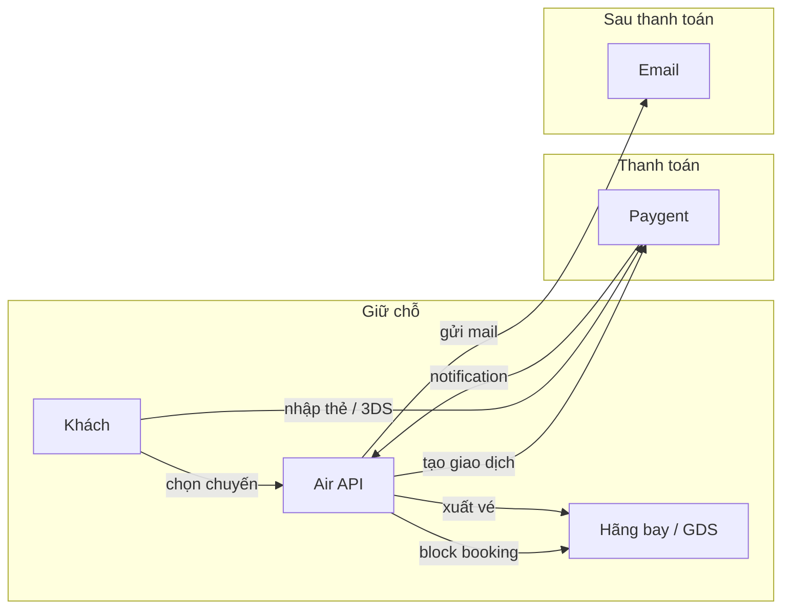

:::warn Bản nháp
Khung này mới có câu hỏi và sơ đồ mẫu. Sơ đồ và mọi con số phải sửa theo hệ thống thật trước buổi present.
:::

Phạm vi: module Air trên hệ thống X, phần thanh toán qua Paygent. Nói về hệ thống mình **và** phía partner: mình gọi gì, partner gọi lại gì, và chuyện gì xảy ra khi một trong hai im lặng.

## Flow thế nào

Cần trả lời:

- Từng bước gọi API nào, đồng bộ hay bất đồng bộ
- Kết quả thanh toán đến bằng đường nào: redirect của khách, notification, hay mình tự hỏi lại Paygent
- Nếu redirect và notification về khác nhau thì tin cái nào

## DB transaction thế nào

- Bảng nào giữ trạng thái booking và trạng thái thanh toán; các trạng thái chuyển ra sao
- Transaction mở ở đâu, commit ở đâu
- Lời gọi Paygent và GDS nằm **trong** hay **ngoài** transaction; nếu trong thì một lời gọi chậm giữ connection và lock bao lâu
- Gọi Paygent thành công nhưng commit DB lỗi thì sao; ngược lại thì sao

## Chịu tải đang thế nào

| Chỉ số | Hôm nay | 10 rps peak | 50 rps peak |
|---|---|---|---|
| Request/ngày | ? | ~40k | ~200k |
| Chỗ nghẽn đầu tiên | ? | ? | ? |
| Connection pool DB | ? | ? | ? |
| Rate limit của Paygent / GDS | ? | ? | ? |

- Số liệu hôm nay lấy từ đâu (log, APM, DB)
- Lên 10 / 50 rps thì cái gì hết trước: pool DB, thread, rate limit của partner
- Khi sập thì đang ra sao: khách thấy gì, booking kẹt ở trạng thái nào, ai phát hiện, phục hồi bằng tay hay tự động

## Security thế nào

- **Block booking:** giữ chỗ bao lâu, ai nhả chỗ khi khách bỏ dở, chặn một người giữ hàng loạt chỗ bằng gì
- **Notification giả:** xác thực notification từ Paygent bằng gì (chữ ký, IP, hỏi lại Paygent)
- **Thanh toán trùng:** khách bấm hai lần, notification đến hai lần thì có trừ tiền hai lần không
- **Exception:** lỗi của Paygent và GDS được map ra sao, khách thấy thông báo gì, log có lộ số thẻ hay token không

## Câu hỏi thảo luận

- Bước nào hôm nay hay phải xử lý bằng tay nhất?
- Nếu được sửa một chỗ, sửa chỗ nào trước?
