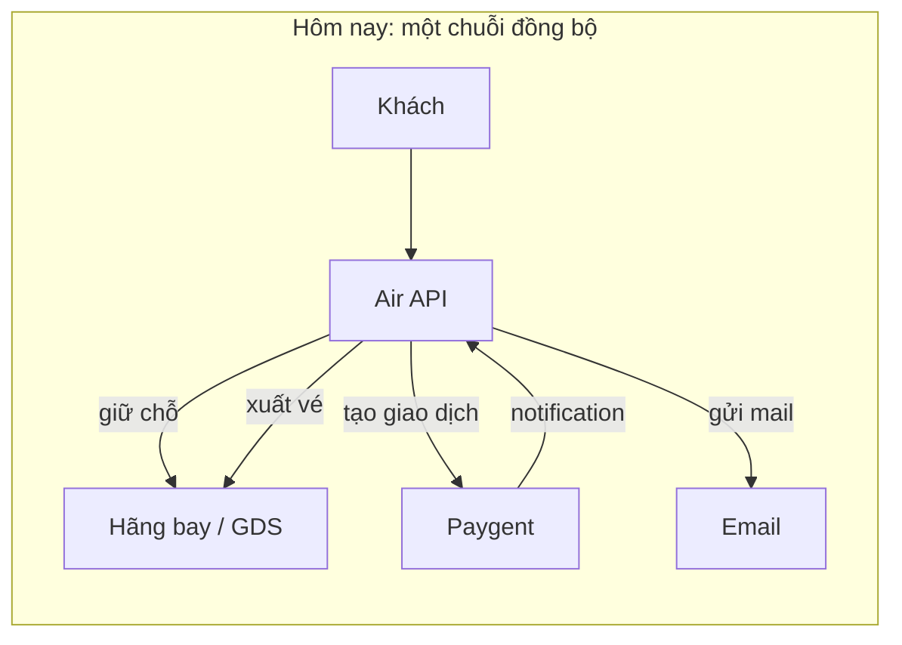
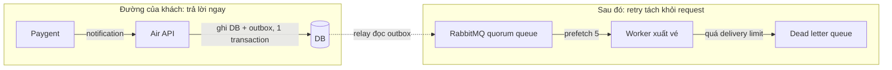

Câu hỏi của buổi này không phải "Kafka hay RabbitMQ tốt hơn", mà là: **nếu hệ thống X (Air + Paygent) có thêm một message broker, thì nên là cái nào, cho luồng nào, và phải trả giá gì.** Phiên bản tham chiếu, tính đến 2026-11: Apache Kafka 4.4, RabbitMQ 4.4.

:::tip Kết luận trước
Ở mức tải của X (10–50 rps), broker **không** cần cho throughput. Nó đáng tiền vì ba việc khác: tách lời gọi chậm khỏi request của khách, retry có kiểm soát, và cho nhiều bên cùng nhận một sự kiện. Với X, RabbitMQ (quorum queue) hợp với retry và hàng đợi công việc; Kafka hợp khi cần một luồng sự kiện cho nhiều consumer đọc lại được.
:::

## Hệ thống X hôm nay (giả định cần xác nhận)

Phần này là giả định để so sánh. Trước buổi present phải sửa lại theo hệ thống thật.

- Luồng đặt vé: giữ chỗ (block booking) → tạo giao dịch ở Paygent → khách thanh toán → nhận kết quả → xuất vé → gửi email
- Các bước sau thanh toán đang chạy **đồng bộ**, trong cùng request hoặc cùng một job
- Kết quả từ Paygent đến bằng notification (callback), có thể đến trễ hoặc đến nhiều lần
- Chưa có broker; retry đang là vòng lặp trong code hoặc job quét DB

Chỗ đau của mô hình này: một bước chậm hoặc lỗi (GDS timeout, mail server chậm) kéo cả chuỗi chậm theo, và retry nằm rải rác trong code.

## Hai mô hình trong một phút

| Tiêu chí | RabbitMQ | Kafka |
|---|---|---|
| Mô hình | Broker đẩy message vào queue, consumer ack thì message biến mất | Log chỉ ghi thêm, chia partition; consumer tự giữ offset |
| Đọc lại | Không, trừ khi dùng RabbitMQ Streams | Có: đọc lại trong thời gian retention |
| Nhiều bên cùng nhận | Mỗi bên một queue bind vào exchange | Mỗi bên một consumer group, cùng đọc một topic |
| Thứ tự | Trong một queue, một consumer | Trong một partition (chọn key = booking id) |
| Retry, delay, DLQ | Có sẵn: delivery limit, DLX, delayed retry (4.3), delayed delivery (4.4) | Tự làm bằng retry topic; share group có DLQ từ 4.4 |
| Vận hành | Nhẹ; quorum queue chạy Raft trên 3 node | Nặng hơn: KRaft (không còn ZooKeeper từ 4.0), partition, replication |

Chi tiết từng mô hình có ở <a href="/topics/08-message-queue#question-08-message-queue.the-two-models.q3">Study Track · RabbitMQ vs Kafka</a>.

## Áp vào từng luồng của X

| Luồng | Nên dùng | Vì sao |
|---|---|---|
| Nhận notification từ Paygent | RabbitMQ quorum queue | Ghi nhận nhanh rồi trả 200, xử lý sau; retry và DLQ có sẵn |
| Xuất vé sau khi đã thanh toán | RabbitMQ, prefetch thấp | GDS chậm và có rate limit; prefetch giới hạn số việc đang chạy |
| Hết hạn giữ chỗ (block booking timeout) | RabbitMQ 4.4 delayed delivery | Kafka không có delay theo từng message |
| Sự kiện `PaymentCaptured`, `TicketIssued` cho kế toán, báo cáo, CRM | Kafka | Nhiều consumer độc lập, đọc lại được khi một bên lỗi |
| Đối soát cuối ngày với Paygent | Kafka (nếu đã có) | Đọc lại toàn bộ sự kiện trong ngày từ offset |

Nếu chỉ chọn một: hai dòng đầu là chỗ X đau nhất hôm nay, và cả hai là bài toán **hàng đợi công việc**, không phải luồng sự kiện. Đó là lý do nghiêng về RabbitMQ trước.

## Được gì, cải thiện gì

- **Request của khách ngắn lại:** notification từ Paygent chỉ cần ghi DB rồi trả lời; xuất vé và gửi mail chạy sau
- **Retry có chính sách:** delivery limit, delayed retry và DLQ thay cho vòng lặp tự viết; message lỗi nằm một chỗ để xem và chạy lại
- **Chịu được partner chập chờn:** GDS hoặc mail sập thì việc nằm chờ trong queue, không mất, không làm hỏng request
- **Thêm bên nhận không sửa bên gửi:** báo cáo hay CRM muốn biết vé đã xuất thì bind thêm một queue (hoặc thêm consumer group nếu là Kafka)
- **Thấy được tắc nghẽn:** độ sâu queue hoặc consumer lag là một con số để cảnh báo

## Tệ đi ở đâu

- **Trùng lặp là chuyện bình thường:** cả hai broker giao *ít nhất một lần*. Consumer xuất vé mà không idempotent thì sẽ có ngày xuất hai vé cho một lần thanh toán
- **Ghi DB rồi gửi message là hai thao tác:** thiếu outbox thì có lúc DB đã commit mà message không đi, hoặc ngược lại
- **Kết quả đến sau:** màn hình khách phải chịu được trạng thái "đang xử lý" thay vì có ngay số vé
- **Debug khó hơn:** một booking đi qua nhiều process; không có correlation id thì không lần lại được
- **Thêm một hệ thống phải vận hành:** cluster, nâng cấp, giám sát, người trực. Kafka nặng hơn RabbitMQ ở khoản này
- **Exactly-once của Kafka không phủ tới Paygent hay DB:** transaction của Kafka chỉ đúng cho đọc-xử lý-ghi trong Kafka; mọi tác dụng ra ngoài vẫn cần idempotency

:::warn Đừng chọn Kafka vì "nó nhanh hơn"
Ở 50 rps, cả hai broker đều chạy dư trên một node. Throughput không phải lý do để chọn cái nào ở mức tải này.
:::

## Mức tải: 10 / 50 rps thì sao

Theo thước đo bốn tier của site: 10 rps peak (~40k req/ngày) nằm giữa T1 và T2; 50 rps peak (~200k req/ngày) nằm giữa T2 và T3.

| Việc | 10 rps peak | 50 rps peak |
|---|---|---|
| Broker để tăng throughput | không cần | không cần |
| Tách xuất vé và email khỏi request | nên có | bắt buộc |
| Outbox + consumer idempotent | bắt buộc | bắt buộc |
| Kafka cho luồng sự kiện | không cần | nên có, nếu có từ hai consumer trở lên |

Chỗ nghẽn thật ở 50 rps không nằm ở broker mà ở **rate limit của GDS và Paygent**. Queue giúp đúng ở đây: prefetch và số worker là van giới hạn số lời gọi đồng thời ra partner.

## Cần xem xét trước khi chọn

1. **Outbox pattern:** ghi trạng thái booking và message vào cùng một transaction, một relay đẩy ra broker (<a href="/topics/08-message-queue#question-08-message-queue.reliability-delivery-semantics.q7">Study Track · Outbox</a>)
2. **Idempotency key:** dùng mã giao dịch của Paygent hoặc booking id; consumer ghi "đã xử lý" trong cùng transaction với tác dụng (<a href="/topics/08-message-queue#question-08-message-queue.reliability-delivery-semantics.q6">Study Track · Idempotent consumer</a>)
3. **Thứ tự:** sự kiện của cùng một booking phải theo thứ tự; Kafka dùng booking id làm key, RabbitMQ thì một queue với single active consumer
4. **DLQ và runbook:** ai xem DLQ, chạy lại bằng gì, khi nào thì hoàn tiền thay vì chạy lại (<a href="/topics/08-message-queue#question-08-message-queue.reliability-delivery-semantics.q5">Study Track · DLQ</a>)
5. **Giám sát:** độ sâu queue, tuổi message cũ nhất, consumer lag; cảnh báo theo tuổi chứ không chỉ theo số lượng
6. **Contract của message:** schema có version, ai sở hữu, thêm field không làm vỡ consumer cũ
7. **Hạ tầng sẵn có:** công ty đã chạy broker nào chưa, có managed service không. Một broker có người vận hành tốt hơn broker "đúng" mà không ai trực

## Đề xuất cho X

- **Bước 1:** RabbitMQ quorum queue + outbox cho notification Paygent và xuất vé; consumer idempotent theo mã giao dịch
- **Bước 2:** dùng delayed delivery cho hết hạn giữ chỗ, bỏ job quét DB
- **Bước 3, chỉ khi cần:** khi có từ hai bên trở lên cần cùng luồng sự kiện và cần đọc lại (kế toán, báo cáo, đối soát), thêm Kafka cho luồng đó; hàng đợi công việc vẫn ở RabbitMQ

## Câu hỏi thảo luận

- Hôm nay retry xuất vé đang nằm ở đâu, và đã bao giờ xuất trùng chưa?
- Notification của Paygent có đến nhiều lần không? Hệ thống đang chống trùng bằng gì?
- Công ty đã có broker nào chạy production chưa?
- Ai sẽ trực broker khi nó sập lúc 2 giờ sáng?

## Nguồn

<ul>
<li><a href="https://www.rabbitmq.com/docs/quorum-queues" target="_blank" rel="noopener noreferrer">RabbitMQ · Quorum queues (delivery limit, delayed retry)</a></li>
<li><a href="https://www.rabbitmq.com/docs/confirms" target="_blank" rel="noopener noreferrer">RabbitMQ · Consumer acknowledgements and publisher confirms</a></li>
<li><a href="https://www.rabbitmq.com/docs/dlx" target="_blank" rel="noopener noreferrer">RabbitMQ · Dead letter exchanges</a></li>
<li><a href="https://github.com/rabbitmq/rabbitmq-server/blob/main/release-notes/4.4.0.md" target="_blank" rel="noopener noreferrer">RabbitMQ 4.4.0 release notes (delayed delivery)</a></li>
<li><a href="https://kafka.apache.org/documentation/#semantics" target="_blank" rel="noopener noreferrer">Apache Kafka · Message delivery semantics</a></li>
<li><a href="https://cwiki.apache.org/confluence/display/KAFKA/KIP-932%3A+Queues+for+Kafka" target="_blank" rel="noopener noreferrer">KIP-932 · Queues for Kafka (share groups)</a></li>
<li><a href="https://docs.aws.amazon.com/prescriptive-guidance/latest/cloud-design-patterns/transactional-outbox.html" target="_blank" rel="noopener noreferrer">AWS Prescriptive Guidance · Transactional outbox</a></li>
</ul>
