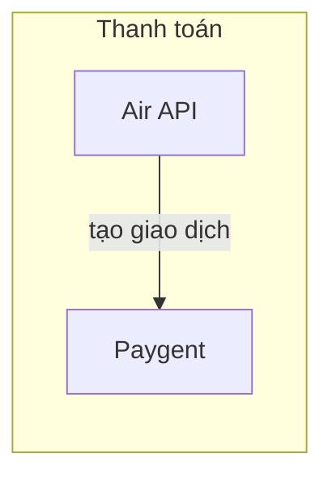

# Presentation playbook

Trang `/presentations` là bảng chủ đề cho buổi chia sẻ hàng tuần: mỗi tuần một
người trình bày hai chủ đề, một **current** (công việc hiện tại ở công ty) và
một **new** (công nghệ mới đã tìm hiểu). Khi present, mở thẳng
`https://gazll.github.io/presentations/<slug>`.

Không cần tài khoản trên site, chỉ cần một tài khoản GitHub. Mọi thay đổi là
một pull request vào repo; CI (`pr-check.yml`) kiểm tra format, merge xong thì
site tự deploy.

Tên công ty và tên dự án luôn viết là **X**; tên partner công khai (Paygent,
hãng bay) giữ nguyên. Repo này public: không đưa vào số liệu nội bộ, tên khách
hàng, endpoint, key hay ảnh chụp có thông tin đó. Lịch sử git không xoá được,
nên kiểm tra trước khi mở PR chứ không phải sau.

## 0. Từ đầu đến cuối (làm hết trên GitHub web)

Một pull request chứa tất cả: dòng trong `board.json`, file bài viết, ảnh.

1. **Chọn chủ đề** trên `https://gazll.github.io/presentations`, ở nhóm
   *Open topics*. Muốn trình bày chủ đề chưa có thì thêm mới ở bước 2.
2. **Nhận chủ đề:** bấm **Claim or add a topic**. GitHub mở `board.json` để sửa
   và tự fork repo về tài khoản của bạn. Đổi dòng của chủ đề thành
   `"status": "preparing"`, thêm `"presenter": "<tên>"` và
   `"date": "YYYY-MM-DD"` (quy tắc ở mục 1). Bấm **Commit changes…** → chọn
   *Create a new branch*, đặt tên như `talk/<slug>` → **Propose changes**.
   Chưa bấm *Create pull request* vội.
3. **Viết bài trên cùng branch đó:** vào fork của bạn
   (`github.com/<bạn>/gazll.github.io`), chọn branch `talk/<slug>` ở nút
   chọn branch, mở `public/data/presentations/talks/` → **Add file → Create
   new file**, tên file `<slug>.md` (đúng slug trong `board.json`). Copy mẫu ở
   mục 3, viết nội dung theo mục 2, commit vào branch `talk/<slug>`.
4. **Ảnh (nếu có):** vẫn trên branch đó, vào `public/assets/presentations/`,
   **Add file → Upload files**, gõ `<slug>/` trước tên file để tạo thư mục,
   commit. Chèn ảnh vào bài như mục 2 · Ảnh.
5. **Mở pull request:** trên fork bấm **Contribute → Open pull request** vào
   `gazll/gazll.github.io` · `main`. Tiêu đề kiểu
   `Talk: <tiêu đề>`, mô tả một dòng nói bài nói về gì.
6. **Đợi CI:** check *Check pull request* chạy vài phút. PR đầu tiên của một
   tài khoản mới cần maintainer bấm *Approve and run* thì CI mới chạy. Đỏ thì bấm
   **Details**, tìm dòng `not ok` hoặc `FAIL`: thông báo ghi rõ file và lỗi
   (ví dụ `talks/x.md: every image needs alt text`). Sửa trên cùng branch, CI
   tự chạy lại.
7. **Sau khi merge:** vài phút sau site deploy. Mở
   `https://gazll.github.io/presentations/<slug>` xem lại bài, sơ đồ, ảnh, ở
   cả theme sáng và tối, trước buổi trình bày.
8. **Sau buổi trình bày:** mở PR nhỏ đổi `"status": "done"` (giữ `date` là
   ngày đã trình bày). Bài sẽ chuyển xuống nhóm *Presented*.

Sửa bài đã merge: mở trang bài, bấm **Edit this talk** ở cuối trang, rồi làm
lại từ bước 5.

**Có clone repo về máy?** Node 22, `npm install --legacy-peer-deps`,
`npm run dev`, mở `http://localhost:3000/presentations/<slug>` để xem trước;
chạy hai lệnh ở mục 4 trước khi push.

## 1. Nhận hoặc thêm chủ đề: `public/data/presentations/board.json`

Mỗi chủ đề là một dòng trong `topics`:

```json
{
  "slug": "kafka-vs-rabbitmq-for-x",
  "kind": "new",
  "title": "Kafka vs RabbitMQ: áp vào hệ thống X thì được gì, mất gì",
  "presenter": "calebzone",
  "status": "preparing",
  "date": "2026-11-20",
  "outline": ["Câu hỏi 1 bài phải trả lời", "Câu hỏi 2"]
}
```

| Field | Quy tắc |
|---|---|
| `slug` | chữ thường, số, dấu `-`; duy nhất; **không đổi** sau khi đã có bài (URL dựa vào nó) |
| `kind` | `current` hoặc `new` |
| `title` | tiêu đề hiển thị |
| `status` | `open` (còn trống) · `preparing` (đã có người nhận) · `done` (đã trình bày) |
| `presenter` | chỉ là tên để ghi chú; bắt buộc khi `preparing`/`done`, không có khi `open` |
| `date` | `YYYY-MM-DD`, ngày trình bày; bắt buộc khi `preparing`/`done`, không có khi `open` |
| `outline` | các câu hỏi bài phải trả lời; hiện thành "Bài này trả lời" ở đầu trang |

- **Nhận chủ đề:** đổi `status` từ `open` sang `preparing`, thêm `presenter` và `date`
- **Thêm chủ đề trống:** thêm một dòng `status: "open"`, chỉ có `slug`, `kind`, `title`, `outline`
- **Trình bày xong:** đổi sang `done`, giữ `date` là ngày đã trình bày. Bài `done` bắt buộc có file bài viết

Trang tự xếp: sắp trình bày (theo ngày) → còn trống → đã trình bày (mới nhất trước).

## 2. Viết bài: `public/data/presentations/talks/<slug>.md`

Trang lo phần khung: tiêu đề, người trình bày, ngày, danh sách câu hỏi, mục lục
và nút sửa. File `.md` chỉ chứa **nội dung**, theo các quy tắc sau:

- **Mỗi `## ` là một phần** (một "slide"), và thành một mục trong mục lục. Đoạn trước `##` đầu tiên là phần mở đầu
- **Không dùng `# `** (tiêu đề cấp 1): tiêu đề lấy từ `board.json`
- Trong một phần được dùng `###`, đoạn văn, `**đậm**`, `*nghiêng*`, `` `code` ``, danh sách `- ` / `1. `, bảng `| a | b |`, khối code ```` ``` ````
- **Danh sách không lồng nhau.** Cần cấp con thì kết thúc danh sách, viết một dòng `**Nhãn:**` rồi mở danh sách mới
- **Callout:**

  ```
  :::tip Kết luận
  Nội dung.
  :::
  ```

  `tip` (xanh) cho kết luận, `warn` (cam) cho cảnh báo
- **Link:** Markdown `[text](url)` không được hỗ trợ; viết HTML `<a href="https://..." target="_blank" rel="noopener noreferrer">text</a>`. Link ngoài phải `https://`
- **Ký tự `<`** trong văn bản viết `&lt;` (renderer không escape)

### Sơ đồ

Chỉ `flowchart` của Mermaid (bản vendored chỉ có loại này):

````

````

Nhãn của node giữ ngắn (≤ 41 ký tự), cơ chế ghi trên mũi tên. CI parse mọi sơ đồ;
sai cú pháp là PR đỏ.

### Ảnh

Đặt ảnh ở `public/assets/presentations/<slug>/`, ưu tiên `.webp` hoặc `.svg`,
ảnh chụp màn hình nén dưới ~400KB. Chèn bằng HTML, **một khối liền không có
dòng trống bên trong**:

```html
<figure><a href="/assets/presentations/<slug>/flow.webp">/flow.webp" alt="Mô tả ảnh" width="1600" height="900" loading="lazy"></a><figcaption>Ảnh nói lên điều gì.</figcaption></figure>
```

Không dùng ảnh từ site khác (CSP chặn). `alt` bắt buộc.

### Bị chặn

`<script>`, `<style>`, `<iframe>`, `<object>`, `<embed>`, thuộc tính `on...=`,
`javascript:`, `http://`. Test sẽ báo lỗi.

## 3. Mẫu bài

**Current** (công việc hiện tại):

```markdown
Phạm vi: module nào, hệ thống mình và partner nào.

## Flow thế nào

## DB transaction thế nào

## Chịu tải đang thế nào

## Security thế nào

## Câu hỏi thảo luận
```

**New** (công nghệ mới):

```markdown
Câu hỏi của buổi này là gì, phiên bản tham chiếu tính đến ngày nào.

## Nó là gì, trong một phút

## Áp vào hệ thống X

## Được gì, cải thiện gì

## Tệ đi ở đâu

## Cần xem xét trước khi chọn

## Đề xuất

## Câu hỏi thảo luận

## Nguồn
```

Nguồn ưu tiên tài liệu gốc: docs của project, RFC, release notes, trang giới hạn
của vendor; ghi "tính đến <ngày>" cho những gì sẽ đổi theo version.

## 4. Trước khi mở PR

```bash
node --test tests/libraries.test.mjs   # board.json và các bài viết
node tools/check-diagrams.mjs          # sơ đồ Mermaid
```

Không chạy được local thì cứ mở PR: CI chạy đủ ba lệnh và báo lỗi trên PR.
